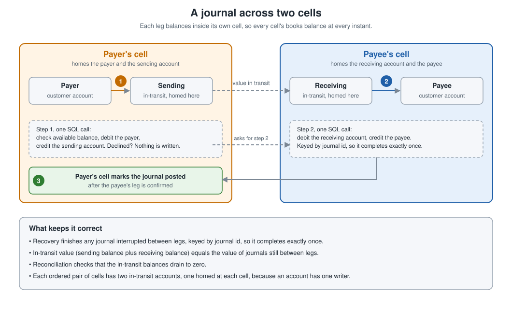
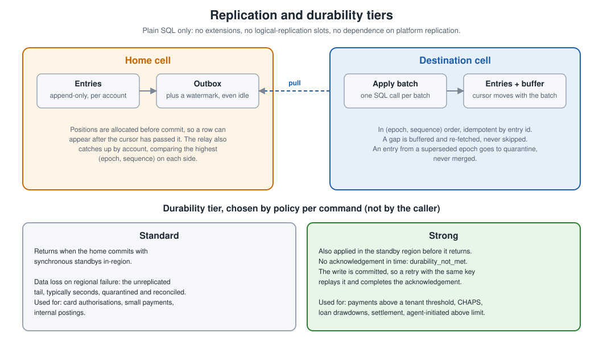
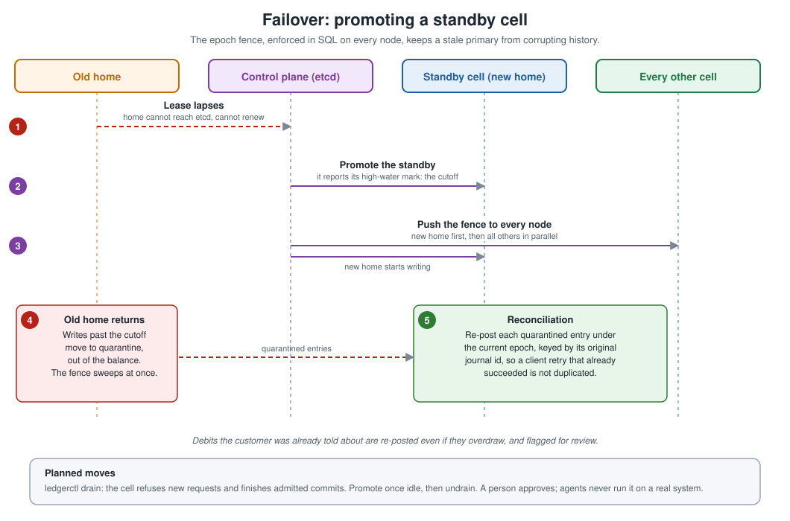

# Open Ledger Kernel: design

This page describes the kernel: the double-entry engine, how cells replicate and fail over, and the invariants that are checked continuously. It uses only standard PostgreSQL 16, so any Postgres can be a node. The code comments link to the headings below.

## The ledger kernel

The kernel is a small, strict double-entry engine: it knows accounts, journals, entries, holds and balances, and nothing about products.

### Data model

| Object | Holds | Rules |
| --- | --- | --- |
| Ledger account | Id, kind (customer, internal, general ledger), currency, normal side, owning cell, epoch, limits, overdraft allowance | One currency per account. Home cell and epoch change only through the control plane |
| Journal | One business event: id, idempotency key, type, state (pending, posted, voided), effective date, actor, policy decision id | The unit a command creates. Its entries must net to zero per currency once posted |
| Entry | Journal id, account, epoch, sequence, signed amount in minor units, value date, posting date | Append-only. Unique on (account, epoch, sequence) and on (journal, account, leg) |
| Hold | Reserved amount against an account: card authorisation, pending payment, lien | Reduces available balance without moving posted balance. Expires or converts to an entry |
| Balance | Posted, pending and available per account, plus accrued interest | A projection rebuilt from entries and holds on every node. Never replicated as state |

Available balance is posted balance minus active holds plus any arranged overdraft. Every debit authorises against available balance at the account's home.

Every object carries a tenant id. Tenants share code, the control plane and the command catalogue, but each has its own cells, encryption keys, chart of accounts, product definitions, policies and agents.

### Cells, homes and epochs

A cell is the unit of failure and of authority: one Postgres primary with synchronous standbys across availability zones, owning a slice of one tenant's accounts. Cells are never shared between tenants. A deployment runs many cells per region, so a cell failure affects a small share of customers.

- Each account is homed on exactly one cell. Only that cell, holding a valid lease from the control plane, writes the account's entries or authorises its debits.
- Each cell has a designated standby cell in another cloud's UK region, so a cloud failure promotes standbys elsewhere and no data leaves the UK. All three regions are in or near London, which keeps the strong tier's extra round trip short.
- Every change of home bumps the epoch and records the sequence number the new home starts from. Entries from an old epoch beyond that point are void on every node, enforced in SQL, so a stale primary cannot corrupt history even if it ignores its lease.
- Healthy homes renew leases continuously. The harness found that without renewal a slow phase lets a lease lapse with nothing wrong.
- A node confirms its lease with the control plane before it serves an account (the lease guard). If the control plane cannot be reached, it keeps serving on the last lease it confirmed, timed on its own monotonic clock from when it sent that confirmation, and stops a safety margin before the lease could lapse at the control plane. It reports this as *unavailable*, never as a lost lease, so a blip never starts a failover by itself. The margin pays for clock drift, a slow reply and a paused node. It does not protect the ledger, because the epoch fence does that. It trades quarantine work (margin too small) against unavailability during a blip (margin too large). The defaults for a 30 second lease are: renew every 10 seconds, stop 6 seconds early (so serve for at most 24 seconds after the last confirmation), and allow the control plane 2 seconds to answer. All four are configuration (`GuardConfig`, or `LEDGER_LEASE_TTL_MS`, `LEDGER_LEASE_RENEW_MS`, `LEDGER_LEASE_SAFETY_MARGIN_MS` and `LEDGER_LEASE_CONFIRM_TIMEOUT_MS`); setting only the ttl scales the others in the same proportions. Values that cannot work together are refused at start: the margin must be under the ttl, a node must renew at least twice inside its serving window, and the confirm timeout must not exceed the renew interval.

### Journals across cells

A journal whose accounts live on different cells is posted in legs, and every leg balances inside its own cell. Each ordered pair of cells has two in-transit internal accounts, one homed at each cell, because an account has one writer and so one sequence of entries. The sending account is homed at the payer's cell, and the receiving account at the payee's:

1. The payer's cell debits the payer and credits the sending account, after checking available balance, in one SQL call.
2. The payee's cell debits the receiving account and credits the payee, in one SQL call.
3. The payer's cell marks the journal posted.

Each cell's books balance at every instant, and the in-transit value (sending balance plus receiving balance) equals the value of journals still between legs. Reconciliation checks that it drains to zero. A recovery process finishes any journal interrupted between legs, keyed by journal id, so it completes exactly once. A journal declined at step 1 writes nothing.

The harness posts the two legs directly against the customer accounts. The in-transit account is the production refinement, so that every cell's trial balance holds at all times.

### Replication

Entries replicate between regions as a pull-based outbox over plain SQL, so the design depends on no platform replication feature.

- Each destination pulls per account in (epoch, sequence) order and applies idempotently by entry id.
- A gap is buffered and re-fetched, never skipped.
- An entry from a superseded epoch is moved to quarantine, never merged.
- Each home publishes a watermark per cell, even when idle, so replicas can report honest lag and the strong tier can confirm its acknowledgement.

The destination applies a batch in one SQL call, which also holds the buffer and moves the cursor, so the rules cannot be bypassed and a batch costs the same round trips whatever its size. Outbox positions are allocated before commit, so a row can become visible after the cursor has passed it. The relay therefore also catches up by account, comparing the highest (epoch, sequence) on each side and fetching what is missing. That closes a hidden gap and needs no ordering guarantee from the source.

### Durability tiers

| Tier | Returns when | Data loss on regional failure | Used for |
| --- | --- | --- | --- |
| Standard | Home cell commits with synchronous standbys in-region | Unreplicated tail, typically seconds, quarantined and reconciled | Card authorisations, small payments, internal postings |
| Strong | Also applied in the standby region | None | Payments above a threshold, CHAPS, loan drawdowns, settlement, anything an agent initiates above its limit |

The tier is chosen by policy per command, not by the caller: strong above a value threshold each tenant sets, and always for CHAPS, loan drawdowns and settlement.

A strong write is an ordinary write at the home followed by an acknowledgement from the remote cell, which returns only once the remote holds every entry of the write in its log. An entry the remote quarantines is not durable. If no acknowledgement arrives in time, the caller gets `durability_not_met`. The write is committed at the home, so a retry with the same key replays it, posts nothing new, and completes the acknowledgement.

### Failover

1. The home's lease lapses because it cannot reach the control plane.
2. The control plane promotes the standby cell, which reports its high-water mark. That becomes the cutoff for the old epoch.
3. The new epoch's fence is pushed to every node, and the new home starts writing.
4. When the old home returns, its writes past the cutoff move to quarantine.
5. Reconciliation re-posts each quarantined entry under the current epoch, keyed by its original journal id, so a client retry that already succeeded is not duplicated. Debits the customer was already told about are re-posted even if they overdraw, and flagged for review.

The database enforces the void rule on every node, however an entry or a fence arrives. Installing a fence sweeps the account at once, moving the entries it voids to quarantine and out of the balance. A void entry, or one already in quarantine, cannot be inserted into the log, and nothing merges a quarantined entry back.

The control plane keeps this in etcd. Each account has a record (home and epoch), a lease key attached to an etcd lease, an optional marker for an expiry on purpose, and one write-once key per fence. Etcd decides when a lease has run out, on its own clock, so a home that cannot reach etcd cannot renew and loses its lease with nobody else having to notice. A promotion is one transaction that compares the account's current record, so two promotions never take the same epoch, and that writes the fence, the new lease and the removal of any forced expiry together. Every node holds a watch on the fence keys. A new watch replays all fences before delivering new ones, so a node that restarts or rejoins needs nothing else, and installing a fence twice is harmless.

The orchestrator does steps 2 and 3 on demand. `ledgerctl promote` (built with `--features failover`, because the etcd client needs `protoc` to build) reads the standby's own high-water mark for the account, asks the control plane for the next epoch with that cutoff, installs the fence on the new home first, then on every other cell at the same time, each with a time limit. A cell that cannot be reached is named in the output and installs the fence from the control plane when it rejoins, so one cut-off cell never holds a promotion up. If the standby cannot be reached, nothing is promoted, because without its high-water mark there is no safe cutoff. Approval stays outside the tool: a person, or a policy a person owns, decides, and agents never run it on a real system.

A planned move drains first. `ledgerctl drain` sets a marker for the cell in the control plane. Each node refuses new requests while its marker is set, lets the commits it has already admitted finish, and reports when it is idle. Draining moves no account and touches no lease, so in-flight work keeps the home and lease it started under. Promote once the old home is idle, and `undrain` to accept requests again.

### Write path performance

On Neon across three regions, each transfer cost 600 to 970 ms when driven from one remote client, because the harness issues about 15 sequential statements per transfer. Production collapses each leg into one stored-procedure call (lock, check, insert, project) and runs the API next to its own cell, so a same-cell leg costs one local round trip. Replication applies in batches per account rather than one entry per call.

### Invariants checked continuously

- Each account's balance equals the sum of its entries, on every node.
- Hash chains over (epoch, sequence) match across nodes for every account.
- Sequence numbers have no holes within an epoch.
- Every posted journal nets to zero per currency, and every cell's trial balance is zero.
- Every in-transit account drains to zero within its time limit.
- No account without an overdraft allowance is negative, except flagged reconciliation postings.
- Quarantine is empty, or every item has an owner and an age under its limit.

`ledgerctl check` runs these against real cells and exits non-zero, naming the cell and the account or journal, when one fails. Cell connection strings come from environment variables and are never arguments. Comparing hash chains across cells is an option, because it only holds once replication has caught up. Quarantine entries have no owner column yet, so the check fails on age alone.

