# Implementation plan

Related: [Core banking design](design.md) · [API design](api-design.md) · [Agent rules](../AGENTS.md) · [Task graph](../plan/tasks.yaml)

This plan takes the open ledger kernel from a Python reference to a stable, released, open-source Rust kernel, proven on real UK clouds. It is a graph of tasks that AI agents pick up, build, test and merge while people own the decisions and the gate. [`plan/tasks.yaml`](../plan/tasks.yaml) is the source of truth. The tables and graphs below are generated from it, and [`AGENTS.md`](../AGENTS.md) sets the rules every agent follows.

The commercial add-on (command engine, products, payments, agents, data, console and launch) is planned in a separate private repository. It starts from the release that Gate 1 tags, so the kernel has to be stable before any of it can be built.

## How to use this plan

1. **Pick a task.** Its status is `todo`, every task in `depends_on` is `done`, its owner is not `human`, and no open pull request has its id in the title.
2. **Check its decisions.** If a listed decision is still open, build behind an interface using the proposed default as an in-memory or simulated implementation. Do not ship the vendor-specific part.
3. **Claim it.** Open a draft pull request titled `[<id>] <title>` from a branch named `task/<id>-<slug>`, setting the task to `in_progress` in `plan/tasks.yaml`.
4. **Build to the acceptance lines.** Each line is a check that must be true, normally proven by a test that runs in CI.
5. **Finish.** Set the task to `done`, run `python plan/render.py`, and merge when every required check is green.

Tasks sized `L` are split into smaller tasks in the task graph before anyone starts them. Human-owned tasks (the gate) are decided by people and never claimed by agents.

## Code layout

The production services are Rust. The Python harness stays as the reference implementation until the Rust conformance suite reaches parity (T-01).

| Path | Language | Holds | Design |
| --- | --- | --- | --- |
| `crates/ledger-core` | Rust | Money, identifiers, journals, invariants; no I/O | [Data model](design.md#data-model) |
| `crates/ledger-store` | Rust and SQL | Migrations, single-round-trip legs, holds, in-transit journals | [The ledger kernel](design.md#the-ledger-kernel) |
| `crates/ledger-repl` | Rust | Outbox relay, batched apply, fencing, quarantine, strong tier | [Replication](design.md#replication) |
| `crates/control-plane` | Rust | Leases, epochs, fences, failover; in-memory and etcd | [Failover](design.md#failover) |
| `crates/ledger-check`, `crates/ledgerctl` | Rust | Invariant checks and the operator command line | [Invariants](design.md#invariants-checked-continuously) |
| `crates/node-agent` | Rust | The agent that runs beside a self-hosted Postgres node | [Self-hosted Postgres](self-hosted-postgres.md) |
| `crates/api` | Rust | The walking-skeleton write path: accounts and transfers over HTTP | [API design](api-design.md) |
| `crates/conformance` | Rust | Scenario, fault-injection and randomised tests | [Conformance](conformance.md) |
| `infra/` | OpenTofu | Three UK clouds, cells, control plane, connectivity | [Infrastructure](infrastructure.md) |
| `ledger/`, `tests/` | Python | Reference harness, retired from active development after T-01 | [Conformance](conformance.md) |

## The gate

| Phase | Goal | Gate |
| --- | --- | --- |
| Stable open kernel | A production-grade Rust ledger kernel, proven on real UK clouds with real network faults, with a thin write path on top | Drills pass on three UK clouds with promotion inside 15 s; latency inside budget; seven clean nightly randomised runs; a first entry made through the API; a v1.0 release tagged |

Gate 1 is a human task. It closes the open kernel, and the commercial add-on builds only on the release it tags.

## Decisions that block work

These are human decisions. A task that lists one can still be built up to its interface, using the proposed default where there is one.

<!-- generated:decisions -->
| Decision | Status | Proposed default, or the decision | Blocks |
| --- | --- | --- | --- |
| **D-02** Managed Postgres service per cloud, and whether Lakebase is available in the UK regions needed | Decided | Any vanilla PostgreSQL 16 will do, with no extensions and no logical replication slots, whether managed on any cloud, self-hosted or Neon for development. Lakebase is the default where Databricks runs. The product does not matter. (Ust Oldfield, 2026-11-14) | None |
| **D-03** Control plane technology across three clouds | Decided | etcd v3, five members spread over the three clouds by default. It must also run with a minimum of three members, because some geographies have only one region. (Ust Oldfield, 2026-11-14) | None |
| **D-14** Latency budget - same-cell leg, cross-cell transfer and strong-tier acknowledgement, p50 and p95 | Open | None yet | I-02 |
| **D-16** Where the credentialed workflows run once the code is public | Decided | The credentialed workflows run on the public repository. Its workflow logs are readable by anyone, so S-07's guards are required, not optional. That means no plan output or identifiers in a log, dispatch only from main, a named approver, and cloud trust pinned to that repository's environment. (Ust Oldfield, 2026-11-19) | None |
<!-- /generated:decisions -->

## Tasks

The kernel is built first because everything else is a client of it. The order follows risk: the single-round-trip leg (K-03) fixes the latency the Neon run exposed, the in-transit journals (K-04) keep every cell's books balanced at every instant, and replication with fencing (R-01, R-02) carries the guarantees the harness proved. The conformance suite (T-01) then holds the Rust kernel to every behaviour the Python harness established, before real network faults (T-02) and randomised runs (T-03) push past what the harness could test. Infrastructure (I-01) runs in parallel. The walking skeleton (K-11 to K-13) puts a thin write path on the kernel so that a first entry can be made before the gate.

<!-- generated:phase-P1 -->
50 of 63 tasks done.

```mermaid
flowchart LR
  F_01["F-01<br/>Rust workspace and CI"]
  F_02["F-02<br/>Local three-node environment with fault proxy"]
  F_03["F-03<br/>Plan tooling and validation"]
  K_01["K-01<br/>Ledger domain types"]
  K_02["K-02<br/>Schema v1 migrations"]
  K_03["K-03<br/>Single-round-trip ledger leg"]
  K_04["K-04<br/>Cross-cell journals through in-transit accounts"]
  K_05["K-05<br/>Holds and available balance"]
  K_06["K-06<br/>Invariant checker"]
  K_07["K-07<br/>ISO 4217 currency list, refreshable from the official source"]
  C_01["C-01<br/>Control plane interface and in-memory implementation"]
  C_02["C-02<br/>etcd control plane"]
  R_01["R-01<br/>Outbox relay and batched apply"]
  R_02["R-02<br/>Fencing and quarantine on apply"]
  R_03["R-03<br/>Strong durability tier"]
  C_03["C-03<br/>Failover orchestrator"]
  T_01["T-01<br/>Conformance suite ported from the harness"]
  T_02["T-02<br/>Real network fault injection"]
  K_08["K-08<br/>Node-side lease guard"]
  K_09["K-09<br/>Recover cross-cell journals by current home"]
  K_10["K-10<br/>Generalise the ledger kernel's vocabulary"]
  K_11["K-11<br/>Write path skeleton, the API service and opening accounts"]
  K_12["K-12<br/>Write path skeleton, transfers over HTTP"]
  K_14["K-14<br/>Write path skeleton, cells call each other for cross-cell transfers"]
  K_15["K-15<br/>The API reaches etcd over mutual TLS"]
  K_13["K-13<br/>Write path skeleton, run the API next to each cell"]
  T_03["T-03<br/>Randomised fault testing"]
  I_01a["I-01a<br/>Infrastructure code scaffold, CI checks and UK-region guard"]
  I_01g["I-01g<br/>Geo-aware region policy, starting with the UK geo"]
  I_01h["I-01h<br/>Region guard ignores attribute names that only contain 'location'"]
  I_01b["I-01b<br/>Network modules for AWS London, Azure UK South and Google Cloud London"]
  I_01c["I-01c<br/>Private cross-cloud connectivity"]
  I_01d["I-01d<br/>Postgres module with a provider setting"]
  I_01e["I-01e<br/>Control plane module (etcd across three clouds)"]
  I_01i["I-01i<br/>Container image for self-hosted Postgres"]
  I_01j["I-01j<br/>Run the Postgres image inside a customer's network"]
  I_01ka["I-01ka<br/>Node agent keeps the administrator's credential in the cloud's secret store"]
  I_01kb["I-01kb<br/>Self-hosted modules run the container image"]
  I_01kc["I-01kc<br/>TLS material reaches self-hosted cloud nodes"]
  I_01m["I-01m<br/>Gated infrastructure workflow"]
  I_01n["I-01n<br/>Enable the Europe geo (north Europe) for proving"]
  I_01oa["I-01oa<br/>Europe root environment, networks layer"]
  I_01ob["I-01ob<br/>Europe root environment, private access and interconnect layers"]
  I_01oca["I-01oca<br/>Europe Azure Key Vault reachable by the plan and apply runs"]
  I_01ocb["I-01ocb<br/>Europe control plane layer and its keys, registries and identities"]
  I_01occ["I-01occ<br/>Europe cell layer for a tenant"]
  I_01p["I-01p<br/>Image manifest, and the control plane layer reads its images from it"]
  I_01q["I-01q<br/>Europe registries layer, before the control plane"]
  I_01r["I-01r<br/>Publish images workflow for etcd"]
  I_01s["I-01s<br/>Import Flatcar into each cloud from a pinned release"]
  I_01t["I-01t<br/>Build and publish the Postgres node image to GitHub Container Registry"]
  I_01u["I-01u<br/>Publish the Postgres node image to each tenant repository"]
  I_01va["I-01va<br/>Europe cells layer, self-hosted cells for the first tenant"]
  I_01vb["I-01vb<br/>Europe cells layer, managed cells"]
  I_01vc["I-01vc<br/>Europe cells layer, Lakebase cell"]
  I_01l["I-01l<br/>Root environment for the UK geo"]
  I_01f["I-01f<br/>Apply the infrastructure to the three UK accounts"]
  I_02["I-02<br/>Region-to-region latency measurement"]
  I_03["I-03<br/>Failover drills on the UK clouds"]
  GATE_1{{"GATE-1<br/>Gate 1: stable open kernel"}}
  S_04["S-04<br/>Apache-2.0 licence for the repository"]
  S_05["S-05<br/>Publish the kernel and infrastructure to OpenLedgerKernel"]
  S_07["S-07<br/>Credentialed workflows for the public repository"]
  F_01 --> F_02
  F_01 --> K_01
  F_02 --> K_02
  K_01 --> K_02
  K_02 --> K_03
  K_03 --> K_04
  K_03 --> K_05
  K_02 --> K_06
  K_01 --> K_07
  K_01 --> C_01
  C_01 --> C_02
  F_02 --> C_02
  K_03 --> R_01
  R_01 --> R_02
  C_01 --> R_02
  R_01 --> R_03
  C_01 --> C_03
  R_02 --> C_03
  K_04 --> T_01
  K_05 --> T_01
  K_06 --> T_01
  R_02 --> T_01
  R_03 --> T_01
  C_03 --> T_01
  T_01 --> T_02
  C_02 --> T_02
  C_02 --> K_08
  T_02 --> K_08
  T_03 --> K_09
  T_03 --> K_10
  K_03 --> K_11
  K_08 --> K_11
  K_11 --> K_12
  K_04 --> K_12
  K_05 --> K_12
  K_12 --> K_14
  K_14 --> K_15
  K_14 --> K_13
  K_15 --> K_13
  S_05 --> K_13
  T_02 --> T_03
  F_01 --> I_01a
  I_01a --> I_01g
  I_01g --> I_01h
  I_01a --> I_01b
  I_01g --> I_01b
  I_01b --> I_01c
  I_01b --> I_01d
  I_01c --> I_01e
  I_01d --> I_01e
  I_01d --> I_01i
  I_01i --> I_01j
  I_01i --> I_01ka
  I_01ka --> I_01kb
  I_01d --> I_01kb
  I_01kb --> I_01kc
  I_01a --> I_01m
  I_01g --> I_01n
  I_01n --> I_01oa
  I_01m --> I_01oa
  I_01b --> I_01oa
  I_01oa --> I_01ob
  I_01c --> I_01ob
  I_01ob --> I_01oca
  I_01oca --> I_01ocb
  I_01e --> I_01ocb
  I_01kc --> I_01ocb
  I_01ocb --> I_01occ
  I_01ocb --> I_01p
  I_01p --> I_01q
  I_01q --> I_01r
  I_01oca --> I_01r
  I_01r --> I_01s
  I_01i --> I_01t
  I_01r --> I_01t
  I_01t --> I_01u
  I_01occ --> I_01u
  I_01u --> I_01va
  I_01kb --> I_01va
  I_01va --> I_01vb
  I_01vb --> I_01vc
  I_01e --> I_01l
  I_01kc --> I_01l
  I_01e --> I_01f
  I_01l --> I_01f
  I_01f --> I_02
  K_04 --> I_02
  R_03 --> I_02
  I_01f --> I_03
  T_01 --> I_03
  C_02 --> I_03
  T_03 --> GATE_1
  I_02 --> GATE_1
  I_03 --> GATE_1
  K_11 --> GATE_1
  K_12 --> GATE_1
  K_13 --> GATE_1
  K_14 --> GATE_1
  S_04 --> S_05
  S_05 --> S_07
  classDef done fill:#E8F5EC,stroke:#166534,color:#14171C
  class F_01,F_02,F_03,K_01,K_02,K_03,K_04,K_05,K_06,K_07,C_01,C_02,R_01,R_02,R_03,C_03,T_01,T_02,K_08,K_11,K_12,K_14,T_03,I_01a,I_01g,I_01h,I_01b,I_01c,I_01d,I_01e,I_01i,I_01j,I_01ka,I_01kb,I_01kc,I_01m,I_01n,I_01oa,I_01ob,I_01oca,I_01ocb,I_01occ,I_01p,I_01q,I_01r,I_01t,I_01u,I_01va,S_04,S_05 done
```

| Task | Workstream | Depends on | Decisions | Size | Owner | Status |
| --- | --- | --- | --- | --- | --- | --- |
| **F-01** Rust workspace and CI | Foundation | None | None | S | Agent | Done |
| **F-02** Local three-node environment with fault proxy | Foundation | F-01 | None | S | Agent | Done |
| **F-03** Plan tooling and validation | Foundation | None | None | S | Agent | Done |
| **K-01** Ledger domain types | Ledger kernel | F-01 | None | S | Agent | Done |
| **K-02** Schema v1 migrations | Ledger kernel | F-02, K-01 | None | M | Agent | Done |
| **K-03** Single-round-trip ledger leg | Ledger kernel | K-02 | None | M | Agent | Done |
| **K-04** Cross-cell journals through in-transit accounts | Ledger kernel | K-03 | None | M | Agent | Done |
| **K-05** Holds and available balance | Ledger kernel | K-03 | None | S | Agent | Done |
| **K-06** Invariant checker | Ledger kernel | K-02 | None | S | Agent | Done |
| **K-07** ISO 4217 currency list, refreshable from the official source | Ledger kernel | K-01 | None | S | Agent | Done |
| **C-01** Control plane interface and in-memory implementation | Control plane and failover | K-01 | None | S | Agent | Done |
| **C-02** etcd control plane | Control plane and failover | C-01, F-02 | D-03 | M | Agent | Done |
| **R-01** Outbox relay and batched apply | Replication | K-03 | None | M | Agent | Done |
| **R-02** Fencing and quarantine on apply | Replication | R-01, C-01 | None | M | Agent | Done |
| **R-03** Strong durability tier | Replication | R-01 | None | S | Agent | Done |
| **C-03** Failover orchestrator | Control plane and failover | C-01, R-02 | None | M | Agent | Done |
| **T-01** Conformance suite ported from the harness | Testing and fault injection | K-04, K-05, K-06, R-02, R-03, C-03 | None | M | Agent | Done |
| **T-02** Real network fault injection | Testing and fault injection | T-01, C-02 | None | M | Agent | Done |
| **K-08** Node-side lease guard | Ledger kernel | C-02, T-02 | None | S | Agent | Done |
| **K-09** Recover cross-cell journals by current home | Ledger kernel | T-03 | None | S | Agent | To do |
| **K-10** Generalise the ledger kernel's vocabulary | Ledger kernel | T-03 | None | M | Agent | To do |
| **K-11** Write path skeleton, the API service and opening accounts | Ledger kernel | K-03, K-08 | None | M | Agent | Done |
| **K-12** Write path skeleton, transfers over HTTP | Ledger kernel | K-11, K-04, K-05 | None | M | Agent | Done |
| **K-14** Write path skeleton, cells call each other for cross-cell transfers | Ledger kernel | K-12 | None | M | Agent | Done |
| **K-15** The API reaches etcd over mutual TLS | Ledger kernel | K-14 | None | S | Agent | To do |
| **K-13** Write path skeleton, run the API next to each cell | Ledger kernel | K-14, K-15, S-05 | None | M | Agent | To do |
| **T-03** Randomised fault testing | Testing and fault injection | T-02 | None | M | Agent | Done |
| **I-01a** Infrastructure code scaffold, CI checks and UK-region guard | Infrastructure | F-01 | None | M | Agent | Done |
| **I-01g** Geo-aware region policy, starting with the UK geo | Infrastructure | I-01a | None | S | Agent | Done |
| **I-01h** Region guard ignores attribute names that only contain "location" | Infrastructure | I-01g | None | S | Agent | Done |
| **I-01b** Network modules for AWS London, Azure UK South and Google Cloud London | Infrastructure | I-01a, I-01g | None | M | Agent | Done |
| **I-01c** Private cross-cloud connectivity | Infrastructure | I-01b | None | M | Agent | Done |
| **I-01d** Postgres module with a provider setting | Infrastructure | I-01b | D-02 | M | Agent | Done |
| **I-01e** Control plane module (etcd across three clouds) | Infrastructure | I-01c, I-01d | D-03 | M | Agent | Done |
| **I-01i** Container image for self-hosted Postgres | Infrastructure | I-01d | D-02 | M | Agent | Done |
| **I-01j** Run the Postgres image inside a customer's network | Infrastructure | I-01i | None | S | Agent | Done |
| **I-01ka** Node agent keeps the administrator's credential in the cloud's secret store | Infrastructure | I-01i | D-02 | M | Agent | Done |
| **I-01kb** Self-hosted modules run the container image | Infrastructure | I-01ka, I-01d | None | M | Agent | Done |
| **I-01kc** TLS material reaches self-hosted cloud nodes | Infrastructure | I-01kb | None | M | Agent | Done |
| **I-01m** Gated infrastructure workflow | Infrastructure | I-01a | None | M | Agent | Done |
| **I-01n** Enable the Europe geo (north Europe) for proving | Infrastructure | I-01g | None | S | Agent | Done |
| **I-01oa** Europe root environment, networks layer | Infrastructure | I-01n, I-01m, I-01b | None | M | Agent | Done |
| **I-01ob** Europe root environment, private access and interconnect layers | Infrastructure | I-01oa, I-01c | None | M | Agent | Done |
| **I-01oca** Europe Azure Key Vault reachable by the plan and apply runs | Infrastructure | I-01ob | None | S | Agent | Done |
| **I-01ocb** Europe control plane layer and its keys, registries and identities | Infrastructure | I-01oca, I-01e, I-01kc | None | M | Agent | Done |
| **I-01occ** Europe cell layer for a tenant | Infrastructure | I-01ocb | None | M | Agent | Done |
| **I-01p** Image manifest, and the control plane layer reads its images from it | Infrastructure | I-01ocb | None | S | Agent | Done |
| **I-01q** Europe registries layer, before the control plane | Infrastructure | I-01p | None | M | Agent | Done |
| **I-01r** Publish images workflow for etcd | Infrastructure | I-01q, I-01oca | None | M | Agent | Done |
| **I-01s** Import Flatcar into each cloud from a pinned release | Infrastructure | I-01r | None | L | Agent | To do |
| **I-01t** Build and publish the Postgres node image to GitHub Container Registry | Infrastructure | I-01i, I-01r | None | M | Agent | Done |
| **I-01u** Publish the Postgres node image to each tenant repository | Infrastructure | I-01t, I-01occ | None | M | Agent | Done |
| **I-01va** Europe cells layer, self-hosted cells for the first tenant | Infrastructure | I-01u, I-01kb | None | M | Agent | Done |
| **I-01vb** Europe cells layer, managed cells | Infrastructure | I-01va | None | M | Agent | To do |
| **I-01vc** Europe cells layer, Lakebase cell | Infrastructure | I-01vb | None | M | Agent | To do |
| **I-01l** Root environment for the UK geo | Infrastructure | I-01e, I-01kc | None | M | Agent | To do |
| **I-01f** Apply the infrastructure to the three UK accounts | Infrastructure | I-01e, I-01l | None | S | Human | To do |
| **I-02** Region-to-region latency measurement | Infrastructure | I-01f, K-04, R-03 | D-14 | S | Agent | To do |
| **I-03** Failover drills on the UK clouds | Infrastructure | I-01f, T-01, C-02 | None | M | Agent | To do |
| **GATE-1** Gate 1: stable open kernel | Gates | T-03, I-02, I-03, K-11, K-12, K-13, K-14 | None | S | Human | To do |
| **S-04** Apache-2.0 licence for the repository | Security and compliance | None | None | S | Agent | Done |
| **S-05** Publish the kernel and infrastructure to OpenLedgerKernel | Security and compliance | S-04 | None | M | Agent | Done |
| **S-07** Credentialed workflows for the public repository | Security and compliance | S-05 | D-16 | M | Agent | To do |
<!-- /generated:phase-P1 -->
