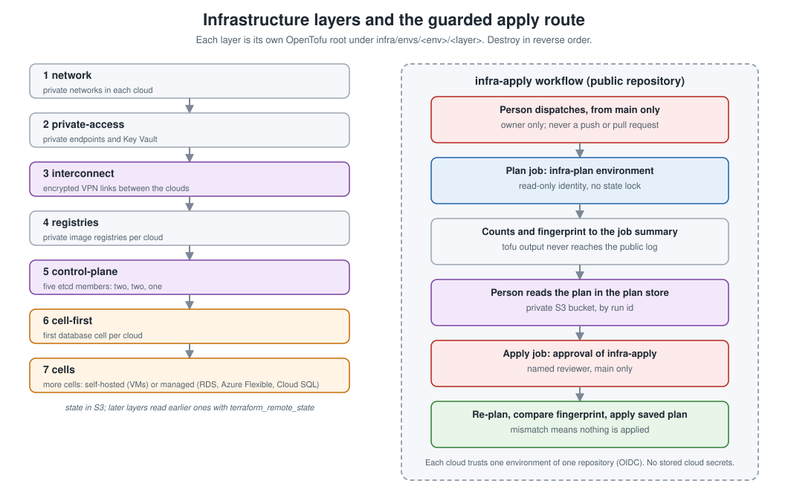

# Running the infrastructure

OpenTofu code in `infra/` builds the architecture across AWS, Azure and Google Cloud: private networks, encrypted links between them, a five-member etcd control plane (two, two and one members), and a database cell on each cloud. `infra/envs/README.md` lists every layer and the variables each one takes.

## Order



Each layer is its own OpenTofu root under `infra/envs/<env>/<layer>`, with state in an S3 bucket. Later layers read earlier ones through `terraform_remote_state`. Apply them in this order:

1. `network`
2. `private-access`
3. `interconnect`
4. `registries`
5. `control-plane`
6. `cell-first`
7. `cells`

Destroy in the reverse order. The VPN gateways in `interconnect` and the private endpoints in `private-access` cost money whether or not anything runs, so only destroying those layers stops that cost.

## Applying a layer

You need credentials for the three clouds, an S3 bucket for state, and the images published (see below). From a layer's directory:

```
tofu init -backend-config="bucket=<state bucket>" -backend-config="key=<env>/<layer>" -backend-config="region=<region>"
tofu plan -out plan.tfplan
tofu apply plan.tfplan
```

The state path `<env>/<layer>` (no extension) is the one the `infra-apply` workflow uses, so state is the same whichever way you apply.

Secrets (the VPN pre-shared key, the administrator's SSH key) are passed as `TF_VAR_*` environment variables and never written to files. Read the plan before you apply it. Changing the kind of a cell replaces it.

## Images

The control plane runs etcd and the cells run the Postgres node image, each pulled from a private registry in its own cloud. `infra/images.json` records each image by digest. The Postgres entry holds a placeholder digest: publish the image from `images/postgres` with the `publish-postgres-image` workflow, then record the digest it prints.

## Before `cell-first`: the Entra group

The tenant's Azure PostgreSQL servers are administered by an Entra group that a person creates once:

```
az ad group create --display-name "<tenant> database administrators" --mail-nickname "<tenant>-db-admins"
az ad group show --group "<tenant> database administrators" --query id -o tsv
```

The second command prints the object id, which goes in `TF_VAR_azure_administrator_object_id` (the name goes in `TF_VAR_azure_administrator_name`). A group's id and name are not credentials.

## Keeping the bill down

Machine sizes in the layers are the module defaults. Pass smaller, burstable sizes for a proving environment (for example `t3.medium`, `Standard_B2s` and `e2-medium`), which are not for production because their CPU is shared. Stopping machines saves compute but not disks, gateways or endpoints.

## Who applies

Applying changes real cloud accounts, so a person does it: from their own shell, or through the `infra-apply` workflow, which is guarded for a public repository and described in [`credentialed-workflows.md`](credentialed-workflows.md). The repository's other CI only formats, validates and lints (`.github/workflows/infra.yml`) and holds no cloud credentials.
